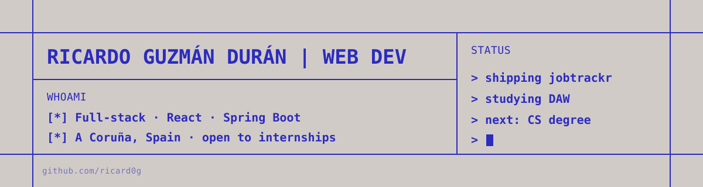
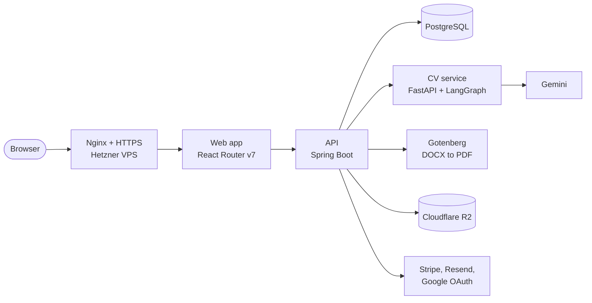

  

Hi, I'm Ricardo, a web developer from A Coruña, Spain. I study Web Application Development (DAW) and start a Computer Science degree next year.

I build full-stack apps with React and TypeScript on the frontend and Java with Spring Boot on the backend. I also like running what I build myself: the server, the database backups and the CI pipeline. Right now I'm looking for a web development internship.

## Projects

### [JobTrackr](https://github.com/ricard0g/jobtrackr)

A SaaS for running a job search. You track applications on a Kanban board, keep companies, interviews and follow-up tasks in one place, and generate a CV tailored to each job offer.

It's my first complete SaaS. I kept it a monolith on purpose so one person can run it, and I deploy and maintain it on my own VPS.

- Spring Boot API with PostgreSQL and Flyway migrations. Spring Security handles sign-in, with Google as the identity provider.
- Stripe for payments, Resend for transactional email, and a landing page built with Astro.
- A separate FastAPI service where LangGraph agents turn the user's CV and a job description into an ATS-friendly CV in PDF, DOCX or Markdown. The agents only reorder and rephrase facts that are already in the user's CV. They don't invent employers, skills or numbers.
- A Hetzner VPS running Ubuntu that I set up and maintain: firewall, Nginx as a reverse proxy, HTTPS with Certbot and Let's Encrypt, and database backups.
- GitHub Actions runs the test suites (JUnit with Testcontainers, Vitest) and publishes Docker images to GHCR. The images contain only the compiled app.

`React Router v7` `TypeScript` `Java` `Spring Boot` `Spring Security` `PostgreSQL` `FastAPI` `LangGraph` `Docker` `Nginx` `Stripe` `Astro`

### [Conviertlo](https://github.com/ricard0g/conviertlo)

A terminal app that converts and compresses media files from plain-language instructions. You type "compress this video to under 25 MB", it asks GitHub Copilot to write the FFmpeg command, shows you the command, and runs it with a progress bar.

- Built with Textual. It has a file browser, batch processing and Vim-style keybindings.
- My first package on [PyPI](https://pypi.org/project/conviertlo/): `pip install conviertlo`.
- I released it the day the GitHub Copilot SDK came out, and Satya Nadella liked the launch post on X.

`Python` `Textual` `GitHub Copilot SDK` `FFmpeg`

### [Abstrakct](https://github.com/ricard0g/abstrakct)

An online store designed as a digital art gallery, built on Shopify's Hydrogen framework. [See it live](https://abstrakct.netlify.app/).

- Headless storefront. The catalog, cart and customer accounts come from the Shopify Storefront API over GraphQL.
- Predictive search that updates on every keystroke, product recommendations, and react-spring animations that work with server-side rendering.

`Shopify Hydrogen` `Remix` `React` `TypeScript` `Tailwind CSS` `Netlify`

### [Expensitrack](https://github.com/ricard0g/expensitrack-web)

A personal expense tracker, and the project where I learned Spring Boot.

- Dashboard with Recharts and TanStack Table. React Router v7 loaders and actions handle data loading and forms.
- [Spring Boot REST API](https://github.com/ricard0g/expensitrack-api) with API-key auth and Bucket4j rate limiting at 20 requests per minute. A scheduled job resets the demo database every hour.
- A Vercel edge function sits between the browser and the API and adds the API key on the server, so the key never reaches the client.

`React Router v7` `TypeScript` `Tailwind CSS` `Java` `Spring Boot` `PostgreSQL` `Vercel`

## What I work with

| Area | Tools |
| --- | --- |
| Frontend | TypeScript, React, React Router v7, Redux, Tailwind CSS, Astro |
| Backend | Java, Spring Boot, Spring Security, Spring Data JPA, Node.js, Express, Python, FastAPI |
| Databases | PostgreSQL, MySQL, MongoDB |
| Testing | JUnit, Testcontainers, Vitest |
| Infrastructure | Docker, Nginx, Linux, GitHub Actions, Hetzner |
| AI | LangGraph, LangChain, GitHub Copilot SDK |

## Contact

- Portfolio: [ricardoguzdev.com](https://ricardoguzdev.com)
- Email: [ricardoguzman444@gmail.com](mailto:ricardoguzman444@gmail.com)

Happy to talk in Spanish or English.
